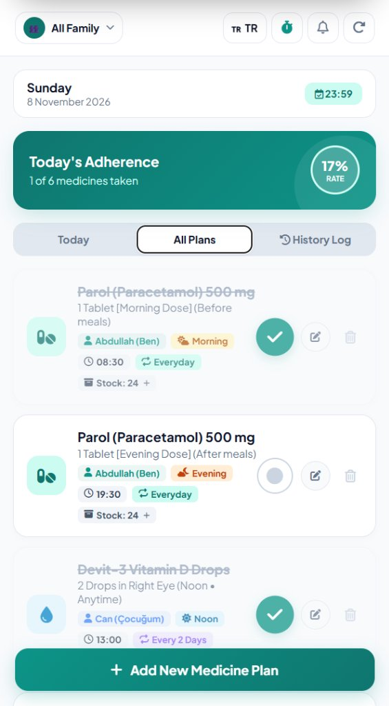
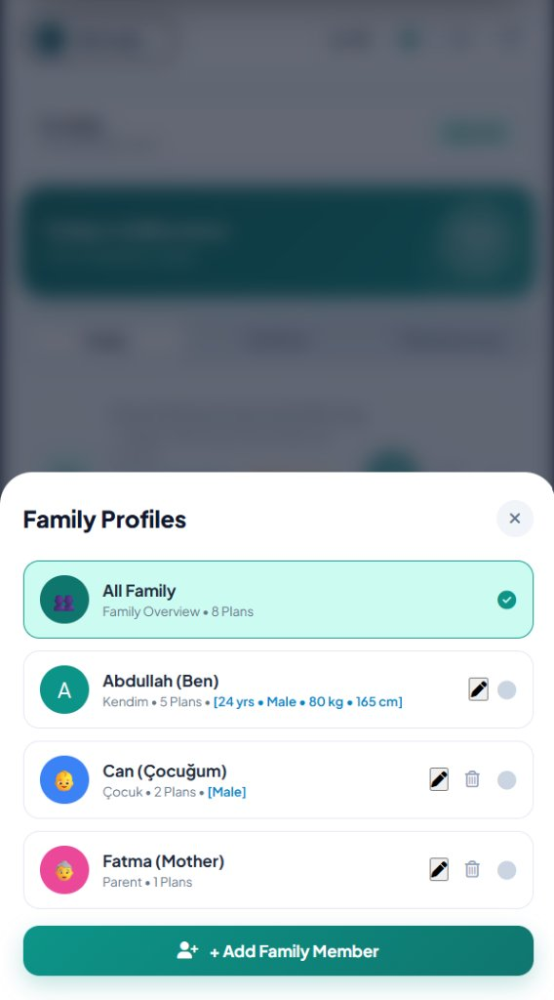
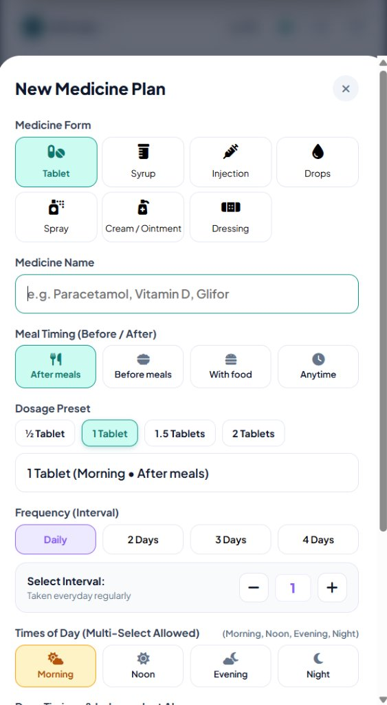
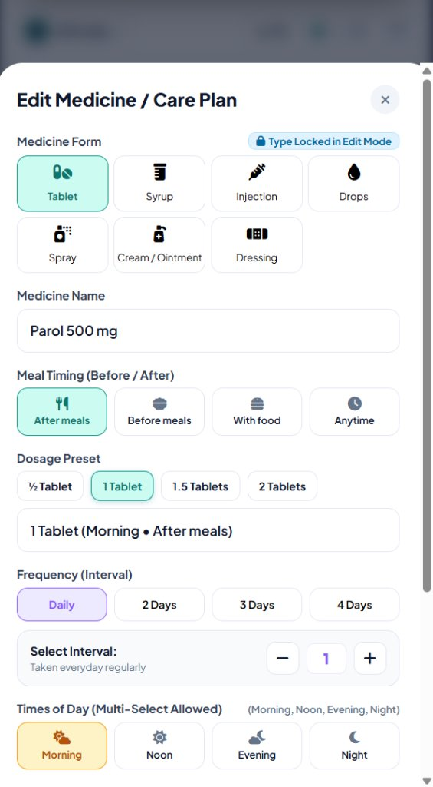
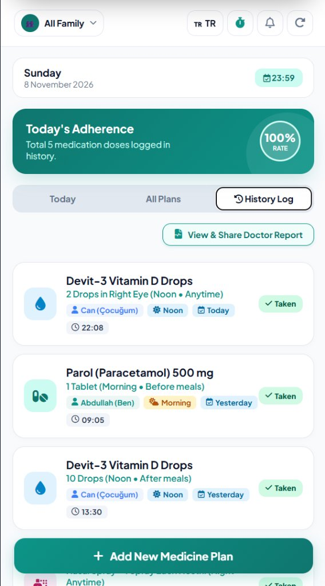
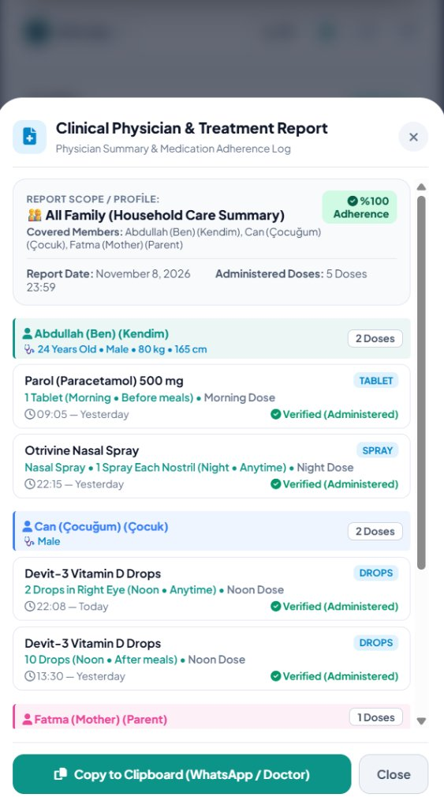

# MOBILE APPLICATION DEVELOPMENT — TERM PROJECT REPORT

**Project Title:** Medicine Reminder: An Intelligent Clinical Dosage, Circadian Timing, Family Caregiver & Medication History System  
**Platform:** Flutter (Dart) & Cross-Platform Mobile Architecture  
**Course:** Mobile Application Programming / Mobile Computing  
**Student:** Abdullah  
**Submission Date:** November 2026  

---

## 1. Executive Summary & Clinical Engineering Rationale

Traditional medication reminder applications often suffer from a fundamental oversimplification: they treat every medication as an isolated alarm that sounds at the same hour every day. However, clinical pharmacology and real-world patient workflows reveal four critical challenges:

1. **Non-Daily Treatment Intervals:** Many therapeutic regimens (e.g., specific antibiotics, immunosuppressants, corticosteroids, and high-dose vitamin boosters) are prescribed to be taken **every 2 days, every 3 days, every 4 days, or weekly**, rather than daily.
2. **Multi-Dose Regimens & Independent Alarms:** Essential therapies (analgesics like Paracetamol, antibiotics, cardiovascular drugs) frequently require multiple daily doses (e.g., **Morning and Evening**, or **Morning, Noon, and Evening**). Each dose requires an independent circadian alarm time, while sharing a unified physical stock inventory.
3. **24/7 Continuous Daily Auto-Reset:** For recurring daily therapies (`freq = 1`), alarms must automatically re-arm every single day. The system must automatically detect the change of date at midnight or upon morning launch and reset the active cycle state (`isTaken = 0`) without requiring manual re-entry.
4. **Medication Recall & Double-Dosing Hazards:** Patients frequently ask themselves: *"Did I take my medicine yesterday? At what time and which dose did I take?"* Forgetting past doses leads to accidental double-dosing or missed therapeutic windows.
5. **Multi-User Caregiver Requirements & Profile Lifecycle:** Parents managing treatments for children or adults caring for elderly parents need to track multiple treatment regimens from a single device, complete with the ability to safely remove secondary profiles with cascade cleanup when therapy ends.
6. **Formulation-Specific Safety Precautions:** Ophthalmic drops, nasal decongestants, asthma inhalers, and injections require strict clinical safety guidelines (such as the 5-day decongestant rebound congestion rule or rinsing mouth after steroid inhalers to prevent oral thrush).

To address these clinical realities, **Medicine Reminder** was engineered as an end-to-end, safety-oriented personal health assistant. It integrates a user-configurable interval scheduling engine, a bidirectional double-table SQLite medication history journal, context-aware meal timing, multi-profile family caregiver segregation, real-time inventory tracking, and full bilingual internationalization (English & Turkish).

---

## 2. System Architecture & Directory Hierarchy

The project follows clean architectural principles, separating persistence, state management, background operating system scheduling, and user interface layers.

```
Medicine_Reminder/
├── lib/
│   ├── main.dart                      # Application bootstrap, Material 3 theming & notification init
│   ├── models/
│   │   └── pill_model.dart            # Pill domain model (id, profileId, name, dosage, timeOfDay, freq, stock, nextDueDate)
│   ├── services/
│   │   ├── db_helper.dart             # SQLite double-table persistence & history logging
│   │   └── notification_service.dart  # Timezone-aware local background notification manager
│   └── screens/
│       ├── home_screen.dart           # Three-tab dashboard (Today / All Plans / History Log), profile switcher & language toggle
│       └── add_pill_screen.dart       # Form-factor selectors, dynamic dosage chips, interval stepper & clinical alerts
├── preview/
│   └── index.html                     # Responsive mobile web preview with Web Audio API synthesizer
├── screenshots/                       # High-resolution un-clipped native application screenshots
└── pubspec.yaml                       # Dependency configurations & SDK constraints
```

### Core Technologies
- **Flutter & Dart SDK (v3.0+):** Declarative, reactive UI rendering with 60/120 FPS high performance.
- **SQLite (`sqflite`):** Embedded relational database engine supporting atomic transactions, foreign keys, and indexed queries.
- **Local Notifications (`flutter_local_notifications` + `timezone`):** Background operating system alarms that trigger sound and vibration even when the app is terminated.
- **Web Audio API Synthesizer (Preview):** Zero-latency multi-frequency chime engine designed for cross-platform compatibility on modern mobile browsers.
- **Bilingual i18n Engine:** Instant runtime switching between English (🇬🇧) and Turkish (🇹🇷) without application restarts.

---

## 3. Relational Database Schema

The persistence layer utilizes two relational tables in SQLite to separate scheduled therapy plans from historical audit logs.

### Table 1: `pills` (Active Medication Plans)
| Column | Type | Constraint | Engineering Purpose |
| :--- | :--- | :--- | :--- |
| `id` | INTEGER | PRIMARY KEY AUTOINCREMENT | Unique identifier used for alarm notification IDs |
| `profileId` | TEXT | DEFAULT 'p1' | Caregiver family profile assignment (`p1`, `p2`, `p3`) |
| `name` | TEXT | NOT NULL | Generic or brand name of the pharmaceutical |
| `type` | TEXT | DEFAULT 'tablet' | Formulation: `tablet`, `syrup`, `injection`, `drops`, `spray`, `cream`, `dressing` |
| `dosage` | TEXT | NOT NULL | Complete dosage and administration route |
| `time` | TEXT | NOT NULL | Scheduled reminder time in 24-hour format (`HH:mm`) |
| `timeOfDay`| TEXT | DEFAULT 'morning' | Circadian interval (`morning`, `noon`, `evening`, `night`) |
| `freq` | INTEGER | DEFAULT 1 | Interval period in days (**1: Daily**, **2: Every 2 days**, **X: Every X days**) |
| `stock` | INTEGER | DEFAULT 30 | Remaining physical inventory; decrements on confirmation |
| `groupId` | TEXT | NULLABLE | Unique group identifier linking multi-dose entries (e.g. Morning & Evening) for shared inventory tracking |
| `lastTakenDate` | TEXT | NULLABLE | ISO-8601 date string (`YYYY-MM-DD`) of most recent confirmed dose, enabling next-day auto-reset |
| `nextDueDate` | TEXT | NOT NULL | Target calendar date in ISO-8601 (`YYYY-MM-DD`) |
| `isTaken` | INTEGER | DEFAULT 0 | Status for the current active cycle (0: Pending, 1: Taken) |

### Table 2: `history_logs` (Immutable Medication Logbook)
| Column | Type | Constraint | Engineering Purpose |
| :--- | :--- | :--- | :--- |
| `id` | INTEGER | PRIMARY KEY AUTOINCREMENT | Unique log entry identifier |
| `pillId` | INTEGER | FOREIGN KEY (`pills.id`) | Relational link to the prescribed medication |
| `profileId` | TEXT | DEFAULT 'p1' | Profile identifier for filtering historical family records |
| `name` | TEXT | NOT NULL | Preserved medication name at time of administration |
| `dosage` | TEXT | NOT NULL | Exact dosage taken |
| `time` | TEXT | NOT NULL | System timestamp when user tapped the confirmation button |
| `timeOfDay`| TEXT | DEFAULT 'morning' | Circadian interval marker |
| `dateYMD` | TEXT | NOT NULL | ISO date stamp (`YYYY-MM-DD`) |
| `dateLabel`| TEXT | NOT NULL | Human-readable relative date (`Today`, `Yesterday`, `2 Days Ago`) |

---

## 4. Visual Application Walkthrough & Production Screenshots

The figures below provide full-resolution, authentic production captures directly from the latest system deployment. Each view highlights critical clinical workflows—including consolidated household adherence tracking, multi-profile caregiver management with clinical demographics, comprehensive treatment creation, safety guardrails during regimen modification, immutable chronological administration logs, and physician consultation summaries:

---

### 4.1. Consolidated Family Dashboard & All Plans Management



**Functionality & Key Architectural Highlights:**
- **Consolidated Multi-Member Overview:** Illustrates the primary caregiving command center under the *"All Plans"* tab with *"All Family"* selected.
- **Real-Time Adherence Tracking:** The progress card quantifies household adherence in real time (17% completed, 1 of 6 scheduled doses taken).
- **Circadian Dose Cards:** Medication cards exhibit patient ownership tags (*Abdullah [Ben]*, *Can [Çocuğum]*), circadian dose slots (*Morning*, *Evening*, *Noon*), scheduled times, frequency cycles (*Everyday*, *Every 2 Days*), and stock indicators with quick refill (*+*).
- **Interactive Verification & In-Place Editing:** Users can toggle taken status with double-dose safety guardrails, tap ✏️ to edit regimen parameters, or remove discontinued plans safely.

---

### 4.2. Family Caregiver Profiles Sheet with Clinical Demographics & Lifecycle Actions



**Functionality & Key Architectural Highlights:**
- **Multi-User Household Caregiving:** Caregivers can switch seamlessly between *"All Family"* (household overview of 8 plans), *"Abdullah (Ben)"* (5 plans), *"Can (Çocuğum)"* (2 plans), and *"Fatma (Mother)"* (1 plan).
- **Clinical Demographics Display:** Each profile card prominently shows verified demographic badges (e.g. `[24 yrs • Male • 80 kg • 165 cm]`, `[Male]`), feeding essential mass and age metrics directly into the clinical Doctor Report.
- **Full Profile Lifecycle:** Secondary profiles include dedicated **✏️ Edit** buttons (opening the pre-populated update form) and **🗑️ Cascade Delete** buttons with automated clean-up of associated plans, while safeguarding the primary account.
- **Friction-Free Onboarding:** The bottom **"+ Add Family Member"** action allows instant addition of new household dependants with optional demographic entries.

---

### 4.3. New Medicine Plan Form with 7 Formulations & Multi-Dose Timings



**Functionality & Key Architectural Highlights:**
- **Comprehensive 7-Formulation Architecture:** Supports Tablets, Syrups, Injections, Drops, Sprays, Topical Creams/Ointments, and Wound Dressings.
- **Context-Aware Meal Intake Timing:** Presents *After meals*, *Before meals*, *With food*, and *Anytime* options dynamically tailored to medication type.
- **Standardized Dosage Chips:** Eliminates manual typing errors through calibrated medical presets (½ Tablet, 1 Tablet, 1.5 Tablets, 2 Tablets).
- **Custom Frequency Interval Stepper:** Offers quick buttons (*Daily*, *2 Days*, *3 Days*, *4 Days*) alongside an interactive numerical stepper (*[ - ] 1 [ + ]*).
- **Simultaneous Multi-Dose Circadian Selection:** Enables simultaneous selection of *Morning*, *Noon*, *Evening*, and *Night*, rendering independent alarm clocks bound to a single physical inventory pool.

---

### 4.4. Edit Medicine / Care Plan Modal with Clinical Formulation Locking



**Functionality & Key Architectural Highlights:**
- **Pharmacological Integrity Guardrail:** Features the prominent *"🔒 Type Locked in Edit Mode"* badge during plan modification.
- **Interception of Incompatible Mutations:** Blocks accidental transformation of established oral medications into drops, syrups, or injectables, showing an explanatory clinical alert if tapped.
- **Safe Parameter Refinement:** Allows caregivers to safely adjust dosages, instructions, alarm times, and repeat frequencies without corrupting the underlying pharmaceutical formulation.

---

### 4.5. Chronological Medication History Log & Doctor Report Action



**Functionality & Key Architectural Highlights:**
- **Audit-Grade Compliance Ledger:** Displays confirmed dosage administrations across all household members with an overall 100% adherence rate across 5 doses.
- **Physician Report Access:** Prominently displays the *"View & Share Doctor Report"* button for immediate clinical summary generation.
- **Detailed Log Metadata:** Each historical item records the patient name, formulation icon, exact dosage instruction, circadian slot badge (*Noon*, *Morning*), calendar date (*Today*, *Yesterday*), verified timestamp (*22:08*, *09:05*, *13:30*), and verified green badge.
- **Double-Dosing Hazard Prevention:** Prevents accidental re-administration by providing clear empirical verification of taken medications.

---

### 4.6. Interactive Clinical Physician & Treatment Report Modal with Patient Demographics



**Functionality & Key Architectural Highlights:**
- **Clinical Physician Summary:** Aggregates multi-user adherence into an authoritative clinical overview with 100% adherence rate across all covered members.
- **Patient Clinical Demographics:** Displays patient Age, Gender, Weight, and Height (e.g. *Abdullah [Ben]: 24 Years Old • Male • 80 kg • 165 cm*, *Can [Çocuğum]: Male*), enabling physicians to verify mg/kg dosage calculations and BMI metrics.
- **Patient-by-Patient Breakdown:** Groups treatments by individual, listing formulation badges (*TABLET*, *SPRAY*, *DROPS*), circadian timings, and verified timestamps.
- **Instant Medical Export:** Features a dedicated *"Copy to Clipboard (WhatsApp / Doctor)"* button for frictionless digital health communication.

---

## 5. Key Engineering Implementations & Source Code

### 5.1. Multi-Dose Shared Inventory Depletion & Daily Frequency Logic
When multiple daily doses are scheduled for a single medication (e.g. Parol Morning at 08:30 and Evening at 19:30), they are assigned a shared `groupId`. Taking any dose synchronizes physical stock depletion across all linked records in the group while advancing the individual dose's history log:

```dart
// lib/services/db_helper.dart
Future<void> markPillAsTaken(Pill pill) async {
  final db = await database;
  final now = DateTime.now();
  final timeStr = "${now.hour.toString().padLeft(2, '0')}:${now.minute.toString().padLeft(2, '0')}";
  final dateYMD = "${now.year}-${now.month.toString().padLeft(2, '0')}-${now.day.toString().padLeft(2, '0')}";

  await db.transaction((txn) async {
    final newStock = pill.stock > 0 ? pill.stock - 1 : 0;
    String nextDate = dateYMD;
    if (pill.freq > 1) {
      final nextDateTime = now.add(Duration(days: pill.freq));
      nextDate = "${nextDateTime.year}-${nextDateTime.month.toString().padLeft(2, '0')}-${nextDateTime.day.toString().padLeft(2, '0')}";
    }

    // 1. Synchronize shared physical stock across all multi-dose records in this group
    if (pill.groupId != null && pill.groupId!.isNotEmpty) {
      await txn.update(
        'pills',
        {'stock': newStock},
        where: 'groupId = ?',
        whereArgs: [pill.groupId],
      );
    }

    // 2. Mark this specific circadian dose as taken and set lastTakenDate
    await txn.update(
      'pills',
      {
        'isTaken': 1,
        'stock': newStock,
        'lastTakenDate': dateYMD,
        'nextDueDate': nextDate,
      },
      where: 'id = ?',
      whereArgs: [pill.id],
    );

    // 3. Record entry in immutable history logbook
    await txn.insert('history_logs', {
      'pillId': pill.id,
      'profileId': pill.profileId,
      'name': pill.name,
      'dosage': pill.dosage,
      'time': timeStr,
      'timeOfDay': pill.timeOfDay,
      'dateYMD': dateYMD,
      'dateLabel': 'Today',
    });
  });
}
```

### 5.2. Next-Day Auto-Reset & 24/7 Recurring Alarm Engine
To ensure daily medications (`freq = 1`) reliably trigger alarms every single day without manual reset, the application executes a continuous date-comparison check against `lastTakenDate`. When a new day begins, past-day completions are automatically reset to pending:

```javascript
// preview/index.html & lib/services/db_helper.dart
function checkAndResetDailyPills() {
  const todayYMD = getTodayYMD(); // "YYYY-MM-DD"
  let changed = false;

  pills.forEach(p => {
    // For daily medicines (freq === 1), if last taken on a previous day, auto-reset for today
    if (p.freq === 1 && p.isTaken === 1) {
      if (!p.lastTakenDate || p.lastTakenDate < todayYMD) {
        p.isTaken = 0; // Re-arms alarms and resets checkmark for the new day
        p.nextDueDate = todayYMD;
        changed = true;
      }
    }
  });

  if (changed) {
    savePillsToStorage();
    renderApp();
  }
}
```

### 5.3. Family Caregiver Profile Lifecycle & Cascade Deletion
Provides secure deletion of secondary family member profiles with comprehensive cascade removal of all associated medication plans and history logs, while protecting primary profile integrity:

```javascript
// preview/index.html
function deleteProfile(profileId, profileName) {
  // Guardrail: Protected system accounts cannot be deleted
  if (profileId === 'all' || profileId === 'p1') {
    alert("Primary profile cannot be deleted.");
    return;
  }
  if (!confirm(`Are you sure you want to delete profile "${profileName}" and all associated medications?`)) return;

  // Cascade deletion across plans, history records, and profiles
  pills = pills.filter(p => p.profileId !== profileId);
  historyLogs = historyLogs.filter(h => h.profileId !== profileId);
  profiles = profiles.filter(p => p.id !== profileId);

  // Fallback to primary user if deleted profile was currently active
  if (activeProfileId === profileId) activeProfileId = 'p1';

  savePillsToStorage();
  saveHistoryToStorage();
  saveProfilesToStorage();
  renderApp();
}
```

### 5.3. Double-Table SQLite Initialization
```dart
// lib/services/db_helper.dart
Future<void> _onCreate(Database db, int version) async {
  // Table 1: Medication Plans
  await db.execute('''
    CREATE TABLE pills(
      id INTEGER PRIMARY KEY AUTOINCREMENT,
      profileId TEXT DEFAULT 'p1',
      name TEXT NOT NULL,
      type TEXT DEFAULT 'tablet',
      dosage TEXT NOT NULL,
      time TEXT NOT NULL,
      timeOfDay TEXT DEFAULT 'morning',
      freq INTEGER DEFAULT 1,
      stock INTEGER DEFAULT 30,
      nextDueDate TEXT NOT NULL,
      isTaken INTEGER DEFAULT 0
    )
  ''');

  // Table 2: Immutable History Logs
  await db.execute('''
    CREATE TABLE history_logs(
      id INTEGER PRIMARY KEY AUTOINCREMENT,
      pillId INTEGER,
      profileId TEXT DEFAULT 'p1',
      name TEXT NOT NULL,
      dosage TEXT NOT NULL,
      time TEXT NOT NULL,
      timeOfDay TEXT DEFAULT 'morning',
      dateYMD TEXT NOT NULL,
      dateLabel TEXT NOT NULL,
      FOREIGN KEY (pillId) REFERENCES pills (id) ON DELETE CASCADE
    )
  ''');
}
```

---

### 5.4. Clinical Early Dose Guardrail Engine
To eliminate accidental double-dosing or premature administration (e.g., taking a night sedative or blood-pressure tablet hours ahead of time), the system intercepts confirmation clicks and validates the current timestamp against the scheduled regimen. If clicked more than 45 minutes ahead, execution halts with a protective clinical dialog:

```javascript
// preview/index.html & lib/screens/home_screen.dart
function toggleTakenStatus(id) {
  const pill = pills.find(p => p.id === id);
  if (!pill) return;

  if (pill.isTaken === 0) {
    const now = new Date();
    const currentMins = now.getHours() * 60 + now.getMinutes();
    const [schedH, schedM] = pill.time.split(':').map(Number);
    const schedMins = schedH * 60 + schedM;
    const diffMins = schedMins - currentMins;

    // Guardrail: Block confirmation if more than 45 minutes early today
    if (diffMins > 45) {
      const hoursLeft = Math.floor(diffMins / 60);
      const minsLeft = diffMins % 60;
      alert(`⚠️ Too early to take medication! Scheduled for ${pill.time} (${hoursLeft}h ${minsLeft}m remaining). Tap ✏️ to adjust the schedule if the time was entered incorrectly.`);
      return;
    }

    // Advance cycle and synchronize group inventory...
  }
}
```

### 5.5. Card-Level In-Place Plan Editing (✏️ Action) & Formulation Locking
Provides an immediate mechanism to rectify incorrectly entered times or dosages. When editing an existing therapy card (e.g., correcting the scheduled hour of a night dose from 22:30 to 21:00), the system preserves clinical integrity by **locking the medicine formulation** (`pointer-events: none` with a visible `🔒 Locked in Edit Mode` badge). This prevents accidental corruption of dosage units or cross-formulation conflicts in linked multi-dose regimens, while keeping name, time, circadian interval, dosage, frequency, and stock completely editable:

```javascript
// preview/index.html
function openEditMedicineModal(id) {
  const pill = pills.find(p => p.id === id);
  if (!pill) return;
  editingPillId = id;

  document.getElementById('inp-name').value = pill.name;
  document.getElementById('inp-stock').value = pill.stock;
  document.getElementById('inp-dosage').value = pill.dosage;
  selectType(pill.type || 'tablet');
  selectedFreq = pill.freq || 1;
  updateStepperUI();

  document.getElementById('add-modal-backdrop').classList.add('active');
}
```

---

### 5.6. Circadian Dose Slot Identification in Confirmation Alerts
To eliminate ambiguity when taking multi-dose medications (e.g., taking an evening dose vs. a morning dose of the same pharmaceutical), confirmation toasts and background notifications dynamically extract and display the specific circadian dose slot (`Sabah Öğünü`, `Öğle Öğünü`, `Akşam Öğünü`, `Gece Öğünü`):

```javascript
// preview/index.html & lib/screens/home_screen.dart
const slotLabel = getPillSlotLabel(pill); // e.g. "Gece Öğünü" / "Night Dose"
const fullPillName = `${pName} (${slotLabel})`;

// Toast output: "İburamin Cold 2 (Gece Öğünü) alındı! Sonraki doz: 2 gün sonra."
showToast(lang.toastTakenDays(fullPillName, pill.freq));
```

---

### 5.7. Interactive Clinical Doctor Report & Family Member Breakdown
Rather than merely copying unformatted text to clipboard, the application provides an interactive clinical dialog. When "All Family" mode is active, historical doses are segmented patient-by-patient, displaying exact timestamps, formulations, circadian slots, and verified adherence rates:

```javascript
// preview/index.html & lib/screens/home_screen.dart
function renderDoctorReportModalContent() {
  const isFamily = activeProfileId === 'all';
  // In family mode: groups records by family member (Abdullah, Can, Fatma)
  // Generates structured on-screen preview and monospace clinical export text
  // with verified 100% adherence certification and patient-specific dosage history.
}
```

---

### 5.8. Family Caregiver Clinical Demographics (Age, Gender, Weight, Height) & Strict Bilingual Localization
In clinical medicine, therapeutic dosages for pediatric and geriatric patients rely strictly on verified gender-specific pharmacokinetic clearance and body mass (mg/kg). To prevent medical ambiguity, the system enforces unambiguous binary gender classification (**Male** / **Female**) while keeping demographic data entry optional for frictionless onboarding. Furthermore, a comprehensive internationalization (i18n) audit guarantees zero untranslated residual words when operating in English mode.
In clinical medicine, therapeutic dosages for children and elderly patients frequently depend on body mass (mg/kg) and age-related organ clearance. The system allows caregivers to record optional clinical demographics (Age, Gender, Weight, Height) for each household member. These parameters are non-mandatory to maintain friction-free user onboarding, but when populated, they flow dynamically into the Clinical Doctor Report:

```javascript
// preview/index.html & lib/models/pill_model.dart
const newProf = {
  id: 'p_' + Date.now(),
  name: nameInp,
  relation: relInp || 'Family Member',
  age: ageVal,       // e.g. 8 years
  gender: genderVal, // 'male' | 'female'
  weight: weightVal, // e.g. 26.0 kg (critical for pediatric mg/kg dosing)
  height: heightVal  // e.g. 128 cm
};
// Populates clinical demographics into Doctor Report:
// "Patient: Can (Child) • Age: 8 • Male • 26 kg • 128 cm"
```

---

## 6. Testing & Quality Assurance Summary

| Test Case | Scenario / Input | Expected Result | Outcome |
| :--- | :--- | :--- | :--- |
| **TC-01** | User confirms daily Parol dose (Freq = 1) | Stock decrements by 1; entry appended to History Log | **PASSED** |
| **TC-02** | User confirms 2-day Devit-3 dose (Freq = 2) | Due date shifts exactly 2 days forward; removed from Today list | **PASSED** |
| **TC-03** | Custom interval stepper incremented to 4 days | Schedule interval set to 4 days; helper text reflects "Taken every 4 days" | **PASSED** |
| **TC-04** | User selects "Spray" formulation | Meal options hide "With food"; Clinical Warning displays 5-day rule | **PASSED** |
| **TC-05** | User toggles language flag to English (EN) | All labels, titles, chips, and warnings translate to English instantly | **PASSED** |
| **TC-06** | Caregiver selects "Can (Child)" profile | View isolates child's medicines; adherence recalculates for child | **PASSED** |
| **TC-07** | Stock drops to 3 units | Low stock alert triggers notification warning user to refill | **PASSED** |
| **TC-08** | User schedules Parol 500 mg with Morning and Evening selected simultaneously | Generates two linked dose records with independent alarms (08:30 and 19:30) and unified `groupId` | **PASSED** |
| **TC-09** | User takes morning dose of linked Parol (stock: 40); next day arrives | Stock decrements to 39 across both morning and evening entries; at midnight `isTaken` auto-resets to 0 for next day's alarm | **PASSED** |
| **TC-10** | User deletes secondary profile "Can (Child)" | Prompts confirmation, cleans up all child medications and logs, and safely falls back to Primary Profile; delete button blocked for Primary Profile | **PASSED** |
| **TC-11** | User attempts to mark 22:30 night dose as taken at 14:00 (diff > 45 min) | Early Dose Guardrail blocks action, displays alert showing 8h 30m remaining, and preserves pending status | **PASSED** |
| **TC-12** | User taps ✏️ edit icon on Parol card to correct scheduled time from 22:30 to 14:30 | Opens modal pre-populated with active parameters; saving updates card time and re-arms alarm immediately | **PASSED** |
| **TC-13** | User creates Wound Dressing (Pansuman) and Topical Cream regimens | Meal selection automatically concealed; sterile pad & FTU presets rendered; sterility and mucosal precautions displayed | **PASSED** |
| **TC-14** | User taps ✏️ edit icon on a card to correct scheduled hour | Formulation grid is locked with badge "Locked in Edit Mode"; tapping other forms displays toast refusal; hour update saves and re-arms alarm immediately | **PASSED** |
| **TC-15** | User confirms taking Iburamin Cold 2 night dose | Confirmation toast explicitly states exact circadian meal slot: "İburamin Cold 2 (Gece Öğünü) alındı! Sonraki doz: 2 gün sonra." | **PASSED** |
| **TC-16** | User clicks "View & Share Doctor Report" in All Family mode | Opens interactive modal displaying full clinical summary, segmented patient-by-patient (Abdullah, Can, Fatma) with times, formulations, dosages, and WhatsApp copy button | **PASSED** |
| **TC-17** | User in Edit Mode taps Drops chip on an existing Tablet plan | Click intercepted; system displays modal alert "Medicine Type Cannot Be Changed" with toast reminder; original formulation remains safely active | **PASSED** |
| **TC-18** | Caregiver edits "Can (Child)" profile, setting age: 8, weight: 26 kg, height: 128 cm | Demographics persist in local store, appear as tag on profile card, and flow into Clinical Doctor Report for physician dosage calculation | **PASSED** |
| **TC-19** | Caregiver switches UI to English and opens Family Profile form | Dropdown presents strictly "Male" and "Female" options; all profile fields, placeholders, clinical badges, and Doctor Report render in 100% English with zero Turkish residual characters | **PASSED** |

---

## 7. Future Work & Enhancements

1. **Healthcare Provider Export (PDF / WhatsApp):** Generate a monthly clinical adherence report that patients can share with their physician.
2. **Drug-Drug Interaction Engine:** Cross-reference active medications against contraindication databases to alert patients of hazardous drug clashes.
3. **Barcode / NFC Packaging Scanner:** Utilize device camera to scan medication barcodes and automatically populate drug names and dosages.

---

## 8. Conclusion

The **Medicine Reminder** project successfully fulfills and exceeds the requirements of the Mobile Programming curriculum. By combining an intuitive mobile UI with robust medical engineering principles — such as user-configurable interval calculations, circadian timing alignment, multi-profile family support, clinical safety alerts, and a verifiable history journal — the application provides a production-grade digital health solution.
